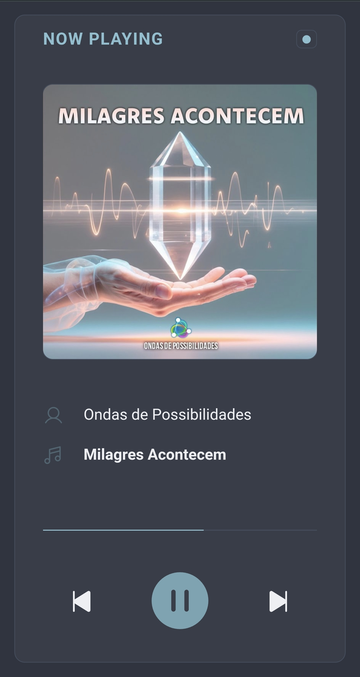
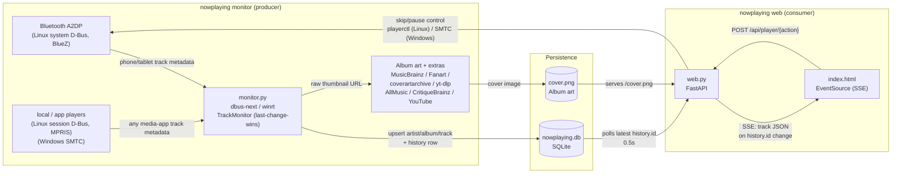

# nowplaying

"now playing" dashboard that captures track metadata from **any media app** and shows it on a minimal web page with playback controls and **live push updates** (no client polling for track data).



| Platform             | Sources (auto-detected)                                                                                                                                          |
| -------------------- | ---------------------------------------------------------------------------------------------------------------------------------------------------------------- |
| Linux / Raspberry Pi | Bluetooth A2DP phones/tablets via BlueZ `MediaPlayer1` (system D-Bus) + local players via MPRIS (`Spotify`, `VLC`, `mpv`, browsers, ...) (session D-Bus)         |
| Windows              | Any app integrated with System Media Transport Controls - `Spotify`, browsers (`YouTube`, `SoundCloud`, ...), `Apple Music`, local players, ... via SMTC/`winrt` |

## How it works

A classic **producer / consumer** split: track metadata lives in a single SQLite database:



- **Monitor** (`nowplaying` command, `src/nowplaying/monitor.py:598-628`): single `TrackMonitor` fed by one platform backend (auto-detected, override with `NOWPLAYING_SOURCE=dbus|windows`). On Linux it runs BlueZ + MPRIS concurrently (last-change-wins): BlueZ reads the nested `MediaPlayer1.Track` dict (`Title`/`Artist`/`Album`/`Duration`) via `sources/dbus_source.py:22-30`, MPRIS reads the flat `Metadata` dict (`xesam:title`/`xesam:artist`/`xesam:album`/`mpris:length` in µs) + `Seeked` via `sources/mpris_source.py:42-65`. On Windows `sources/windows_source.py:104-124` subscribes to SMTC `MediaPropertiesChanged`/`TimelinePropertiesChanged`, so **any** app with system media controls is tracked (Spotify, browser tabs, etc.). Every signal is applied atomically and written only on real change (one `history` row per track change, position ticks stay out of `history`). It also resolves covers (`MusicBrainz` release-group → `Fanart.tv` → `coverartarchive` → optional `yt-dlp` YouTube thumbnail), album reviews (`AllMusic` → `CritiqueBrainz`) and YouTube descriptions, caching per album/video.
- **Web server** (`uvicorn nowplaying.web:app`, `src/nowplaying/web.py:55`): FastAPI app that serves the dashboard (`web/index.html`), versioned album art (`/cover.png?v=`), and one SSE stream (`GET /api/track/stream`) multiplexing `track` + `position` + `status` events with `: ping` heartbeats. Playback buttons (`POST /api/player/{play-pause,next,previous}`) drive `playerctl` on Linux or SMTC on Windows.

## Requirements

- Python >= 3.11, [uv](https://docs.astral.sh/uv/)
- **Linux (Pi):** system D-Bus (BlueZ) + session D-Bus (MPRIS); `playerctl` optional (playback buttons), `yt-dlp` optional (album-art fallback)
- **Windows:** Windows Media Session (SMTC, built in); no D-Bus, no `playerctl`

## Quick start

```bash
cp .env.example .env   # optional overrides only
```

### Linux (Raspberry Pi)

```bash
uv sync --extra dbus
uv run nowplaying        # producer: BlueZ + MPRIS via D-Bus
uv run nowplaying-web    # consumer: http://<device-ip>:4940
```

### Windows

```powershell
uv sync --extra windows
uv run nowplaying        # producer: SMTC via winrt
uv run nowplaying-web    # consumer: http://<device-ip>:4940
```

Data dir: `~/.local/share/nowplaying/` on Linux, `%LOCALAPPDATA%\nowplaying\` on Windows. Override with `NOWPLAYING_DB` / `NOWPLAYING_COVER`. Source auto-detects from OS; force with `NOWPLAYING_SOURCE=dbus|windows`.

## Configuration

All knobs are env vars (real env -> `.env` -> defaults). See `.env.example`.

| Variable                              | Default                                | Purpose                                                       |
| ------------------------------------- | -------------------------------------- | ------------------------------------------------------------- |
| `NOWPLAYING_DB`                       | `<data-dir>/nowplaying.db`             | SQLite database path (all track state lives here)             |
| `NOWPLAYING_COVER`                    | `<data-dir>/cover.png`                 | Trimmed album-art image file                                  |
| `NOWPLAYING_HOST` / `NOWPLAYING_PORT` | `0.0.0.0` / `4940`                     | Web server bind                                               |
| `NOWPLAYING_SOURCE`                   | `dbus` on Linux / `windows` on Windows | Track source backend (`dbus` = BlueZ+MPRIS, `windows` = SMTC) |
| `YT_DLP`                              | *(off)*                                | Allow the yt-dlp YouTube search fallback for album art        |
| `FANART_API_KEY`                      | *(shared project key)*                 | Fanart.tv key (falls back to built-in project key)            |
| `GOOGLE_API_KEY`                      | *(off)*                                | YouTube Data API key for per-track descriptions               |
| `SKIP_FOREVER`                        | *(off)*                                | Auto-skip tracks skipped via Next 3+ times                    |
| `PREVIOUS_LOVE`                       | *(off)*                                | Show a heart for tracks Previous-ed via 3+ times              |
| `PLAYERCTL_PLAYER`                    | *(empty)*                              | Hardcode MPRIS player if needed                               |
| `NOWPLAYING_DEBUG`                    | *(off)*                                | Verbose logging to `NOWPLAYING_DEBUG_LOG`                     |

## HTTP API

Swagger UI at `http://<device-ip>:<port>/docs`

## Use cases

I made this after plugging my amp to my raspberry pi, making it bluetooth receiver while wanted access and control from any device in my LAN. It has since grown into a generic now-playing display for whatever is actually producing sound:

- **Any-app dashboard** - Spotify desktop, browser tabs (YouTube/SoundCloud/Bandcamp), VLC/mpv, Apple Music, or a phone over Bluetooth A2DP all show up on the same page with no per-app setup.
- **Smart home / wall-mounted dashboard** - show what's playing on a shared speaker or Hi-Fi in a living room, office, updating live.
- **Home theater / music room display** - a tiny screen showing track, artist, album art, review and progress bar while audio plays from any source.
- **LAN remote control** - the built-in buttons drive the active player (`playerctl` on Linux, SMTC on Windows), so you can pause/skip without touching the source.
- **Playback history / stats** - the monitor records every track change as a row in the `history` table, so play history and listening stats can be queried from the same database.
- **Skip / auto-skip** - pressing **Next** counts a skip for the current track in the `skips` table (always recorded). With `SKIP_FOREVER` enabled, any track skipped 3 or more times is auto-skipped (`playerctl next`) the next time it plays; auto-skipped tracks are logged to `history` (as `auto_skipped`) but never shown as the current track.
- **Favourites / loved** - pressing **Previous** while a track is playing counts a favourite for that track in the `favourites` table (always recorded). With `PREVIOUS_LOVE` enabled, a track favoured 3 or more times is shown as **loved** with a heart icon on its Title row.

## Deployment

Linux only - units in `systemd/`:

```bash
cp systemd/nowplaying.service systemd/nowplaying-web.service ~/.config/systemd/user/
systemctl --user daemon-reload
systemctl --user enable --now nowplaying nowplaying-web
```

Windows: no service file - run the two `uv run` commands above, or schedule them via Task Scheduler.
